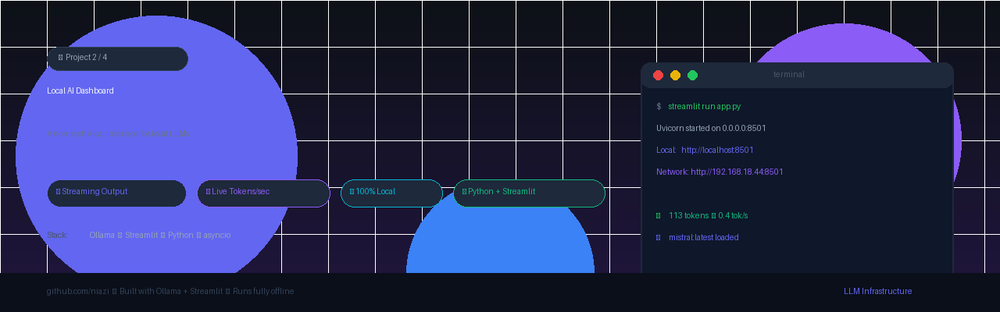
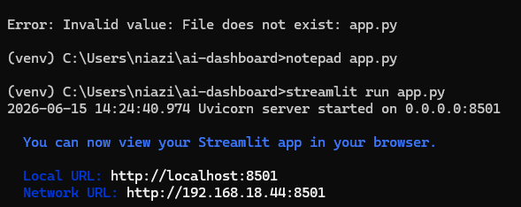
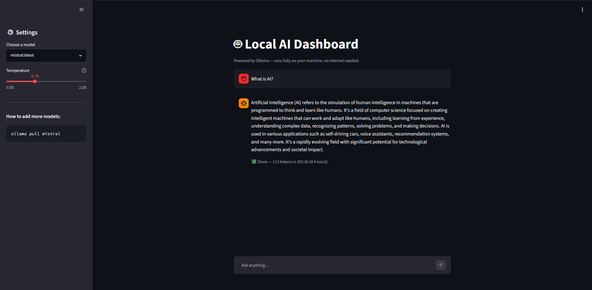

# 🤖 Local AI Dashboard



> **Project 2 of 4** — One-night LLM infrastructure projects built to prep for an AI/ML internship.

A clean, non-technical chat interface that talks to a **local Mistral model** via Ollama. No cloud. No API keys. No costs. Runs 100% on your own machine.

---

## 📸 Screenshots

| Terminal — Server Running | Dashboard — Live Response |
|:---:|:---:|
|  |  |

---

## ✨ Features

- 🔄 **Streaming output** — tokens appear word-by-word in real time, just like ChatGPT
- ⚡ **Live tokens/sec counter** — see your model's throughput live as it generates
- 🎛️ **Model selector** — switch between any Ollama model you have pulled, from a dropdown
- 🌡️ **Temperature slider** — tune creativity vs precision without touching code
- 💬 **Full chat history** — maintains conversation context within a session
- 🔒 **100% local** — no data leaves your machine, no internet required

---

## 🛠️ Tech Stack

| Tool | Purpose |
|---|---|
| [Ollama](https://ollama.com) | Local LLM runtime — runs Mistral on your CPU |
| [Streamlit](https://streamlit.io) | Python UI framework — turns a script into a web app |
| `ollama` Python SDK | Talks to the local Ollama server, handles streaming |
| `asyncio` / `time` | Token timing and throughput calculation |

---

## 🚀 Run It Yourself

### 1. Prerequisites

```bash
# Install Ollama from https://ollama.com, then:
ollama pull mistral
ollama serve
```

### 2. Clone & Install

```bash
git clone https://github.com/YOUR_USERNAME/ai-dashboard
cd ai-dashboard
python -m venv venv
venv\Scripts\activate        # Windows
# source venv/bin/activate   # Mac/Linux
pip install streamlit ollama
```

### 3. Launch

```bash
streamlit run app.py
```

### 4. Open in Browser

| Access | URL |
|---|---|
| 🖥️ Local (your machine) | http://localhost:8501 |
| 🌐 Network (share with others on same WiFi) | http://192.168.18.44:8501 |

> Anyone on your local network can use the dashboard from the Network URL — no installation needed on their end.

---

## 📂 Project Structure

```
ai-dashboard/
├── app.py              # Main Streamlit application
├── banner.png          # Project banner
├── README.md           # This file
└── screenshots/
    ├── 01_terminal_server.png    # Terminal showing server startup
    └── 02_dashboard_response.png # Dashboard with live AI response
```

---

## 🧠 What I Built & What I Learned

### What I Built
A fully local AI chat dashboard in Python — a non-technical user can open a browser, pick a model, and chat with a local LLM without ever touching a terminal. The UI streams tokens in real time and shows live throughput metrics (tokens/sec) after every response.

### What I Learned

**`stream=True` in Ollama** — Instead of waiting for the full response, Ollama sends tokens one by one as they're generated. This is how ChatGPT's streaming UX works under the hood. I learned to consume this stream chunk-by-chunk and update the UI live using `st.empty()` placeholders.

**Streamlit's session state** — Streamlit reruns the entire Python script on every user interaction. `st.session_state` is the only memory that survives between reruns, so all chat history lives there. Understanding this execution model is key to building any stateful Streamlit app.

**Throughput measurement** — Tokens per second (tok/s) is the core metric for LLM inference performance. I measured it live: `token_count / elapsed_time`. This connects directly to the latency benchmarking I did in Project 1 (TTFT + throughput).

**Local vs cloud tradeoffs** — Mistral running on CPU gave ~0.4 tok/s — slow compared to cloud APIs, but zero cost and zero data exposure. This is the exact tradeoff that matters for on-premise AI deployments.

**UI abstraction over infrastructure** — The biggest insight: the hardest part isn't the model, it's making the model accessible. A well-designed UI that hides all the complexity is as important as the model itself.

---

## 📌 Part of a Series

| # | Project | Status |
|---|---|---|
| 1 | LLM Latency Benchmarker | ✅ Done |
| **2** | **Non-technical AI Dashboard** | **✅ Done** |
| 3 | GGUF Quantization Comparator | 🔄 In Progress |
| 4 | Minimal RAG Pipeline | ⏳ Upcoming |

---

## 👤 Author

**Niazi** — Building LLM infrastructure projects for an AI internship application.

> *"The best infrastructure is invisible — it just works."*
